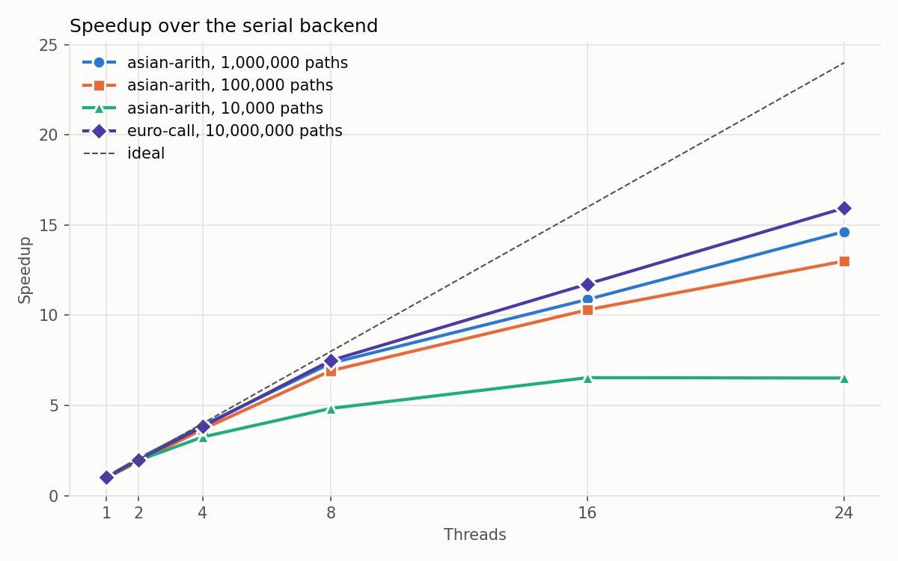
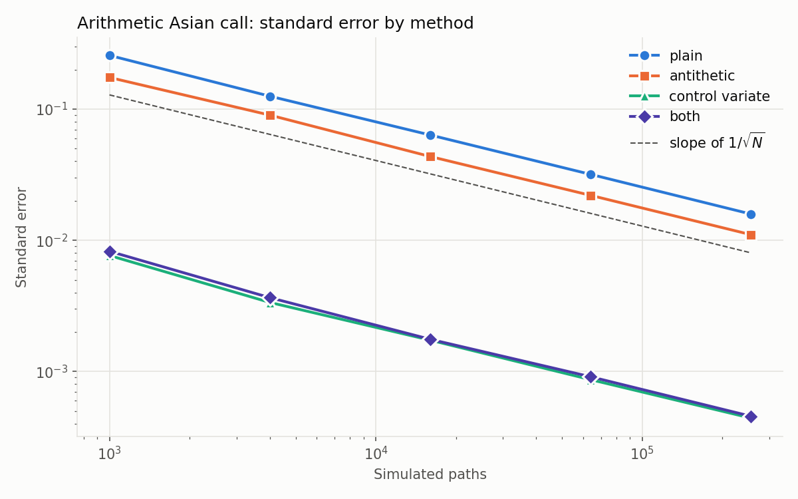

# mcpricer

A Monte Carlo option pricer in C++20. It prices European and Asian options under geometric
Brownian motion, reports an honest error estimate with every price, and runs on interchangeable
execution backends. **The serial and threaded backends return bit-identical results for any number
of threads.**

- Options: European, arithmetic-average Asian, geometric-average Asian (calls and puts)
- Variance reduction: antithetic variates and control variates, separately or combined
- Closed forms for validation: Black-Scholes with Greeks, and the discrete geometric Asian
- Counter-based random numbers (Philox4x32-10), chosen to carry over to a GPU
- 78 tests, including confidence-interval calibration

Further reading: [PLAN.md](PLAN.md) (design), [docs/LEARNING.md](docs/LEARNING.md) (concepts
explained), [docs/CUDA_ROADMAP.md](docs/CUDA_ROADMAP.md) (planned GPU backend).

## Example

```
$ mcpricer --type asian-arith --S0 100 --K 100 --r 0.05 --sigma 0.2 --T 1 --steps 252 --paths 1000000 --backend threaded --antithetic --cv
Option        asian-arith  S0=100 K=100 r=0.05 q=0 sigma=0.2 T=1 steps=252
Simulation    1000000 paths, 500000 independent samples, seed 42, threaded, antithetic, control variate

MC price      5.781813
Std error     2.308e-04
95% CI        [5.781360, 5.782265]
CV beta       1.032334
Analytic      no closed form
Wall time     262.36 ms  (3.81 M paths/s)
```

With `--type euro-call` there is a closed form to compare with:

```
MC price      10.463957
Std error     1.473e-02
95% CI        [10.435077, 10.492837]
Analytic      10.450584  (MC differs by +0.91 standard errors)
```

## Build and run

Requires a C++20 compiler and CMake 3.24 or newer. Configuring downloads GoogleTest 1.17.0.

**Windows, Visual Studio Build Tools 2026.** If `cmake` is not on your PATH, use the copy bundled
with the Build Tools. In Git Bash:

```bash
export PATH="/c/Program Files (x86)/Microsoft Visual Studio/18/BuildTools/Common7/IDE/CommonExtensions/Microsoft/CMake/CMake/bin:$PATH"
cmake --preset msvc
cmake --build --preset msvc-release
ctest --preset msvc-release
./build/msvc/apps/Release/mcpricer.exe --help
```

**Windows, MinGW GCC:**

```bash
cmake --preset gcc
cmake --build --preset gcc-release
ctest --preset gcc-release
./build/gcc/apps/mcpricer.exe --help
```

**Other compilers:** `cmake -S . -B build && cmake --build build --config Release`, then
`ctest --test-dir build -C Release`. Only the two Windows toolchains above have been tested.

| CMake option | Default | Effect |
|---|---|---|
| `MCPRICER_BUILD_TESTS` | ON | Build the tests |
| `MCPRICER_BUILD_BENCHMARKS` | ON | Build `mcpricer_bench` |
| `MCPRICER_WARNINGS_AS_ERRORS` | OFF (ON in presets) | Fail on warnings |
| `MCPRICER_SANITIZER` | empty | `address`, or `thread` (not with MSVC) |
| `ENABLE_CUDA` | OFF | Build the CUDA backend, currently a stub |

## The math

**Model.** Under the risk-neutral measure, dS = (r − q) S dt + σ S dW. An option is worth its
expected discounted payoff, V = e^(−rT) E[payoff]. The process is simulated in log space with its
exact solution, so there is no time-discretisation error:

    ln S(t + dt) = ln S(t) + (r − q − σ²/2) dt + σ √dt Z,   Z ~ N(0, 1)

Europeans therefore need only one step. Asians are monitored at iT/N for i = 1..N.

**Estimator.** The price is the mean of n independent discounted payoffs. Its standard error is
s / √n, with s the sample standard deviation, and the 95% confidence interval is ±1.96 standard
errors. Halving the error takes four times the samples.

**Antithetic variates.** Each path driven by Z is paired with one driven by −Z. The payoffs here
are monotone in Z, so the two are negatively correlated and their average varies less. A pair is
**one** observation when computing the standard error.

**Control variate.** A quantity Y with a known mean is observed on the same paths, and the
estimate is corrected by how far Y's sample mean missed: X̄ − β(Ȳ − E[Y]), β = Cov(X, Y) / Var(Y).
The variance falls by the factor 1 − ρ². European options use the discounted terminal price;
arithmetic Asians use the geometric Asian, which is almost perfectly correlated with them.

## Tests

78 tests pass on MSVC 19.51 (Debug and Release) and GCC 15.2 (Release), with warnings as errors.
The suite also passes under MSVC AddressSanitizer.

| Area | What is checked |
|---|---|
| Random numbers | Published Random123 vectors, moments up to the fourth, no correlation between or along streams |
| Closed forms | Published values, put-call parity, Greeks against finite differences, geometric Asian against numerical integration |
| Engine | Within 3 standard errors of the closed form on six parameter sets, parity, 1/√N convergence of both the reported and the **actual** error |
| Error bars | 95% intervals cover the true price in 92–98% of 400 runs, for plain and every variance reduction method |
| Variance reduction | Lower standard error; European control matches the theoretical √(1 − ρ²) within 2% |
| Backends | Bit-identical prices and standard errors for 1, 2, 3, 8 and all threads |
| Edge cases | Zero and tiny σ and T, deep in and out of the money, overflow, invalid input, malformed command lines |

Seeds were fixed in advance and not tuned. The GitHub Actions workflow, which includes
ThreadSanitizer on Linux, has not been run yet.

## Benchmarks

Intel Core i7-14650HX (8 performance and 8 efficiency cores, 24 hardware threads), Windows 11,
mains power, balanced power plan. MSVC 19.51, `/O2 /Ob2 /DNDEBUG`. Median of 5 runs after a
warm-up; speedup is relative to the serial backend. Raw data: [bench/results](bench/results).

| Workload | Serial | 2 threads | 4 | 8 | 16 | 24 | Best rate |
|---|---|---|---|---|---|---|---|
| Asian, 252 steps, 10⁴ paths | 65.1 ms | 1.95x | 3.25x | 4.84x | 6.54x | 6.52x | 1.0 M paths/s |
| Asian, 252 steps, 10⁵ paths | 630 ms | 1.89x | 3.68x | 6.93x | 10.30x | 13.00x | 2.1 M paths/s |
| Asian, 252 steps, 10⁶ paths | 6388 ms | 2.04x | 3.89x | 7.34x | 10.88x | 14.64x | 2.3 M paths/s |
| European, 10⁶ paths | 66.0 ms | 1.97x | 3.78x | 6.65x | 9.92x | 11.48x | 174 M paths/s |
| European, 10⁷ paths | 659 ms | 1.99x | 3.82x | 7.49x | 11.73x | 15.94x | 242 M paths/s |



How to read this:

- Scaling is close to ideal up to 8 threads, the number of performance cores. Beyond that, threads
  land on slower efficiency cores or share a core through hyper-threading, so a 24x speedup is not
  attainable on this CPU. It is also a laptop, whose clock speed depends on load and temperature.
- At 10⁴ paths there are only 10 chunks of work, so at most 10 threads can be busy.
- Values slightly above ideal (2.04x) are measurement noise.

**What variance reduction buys**, for 256,000 paths on one thread. Efficiency is
1 / (variance × time), relative to plain Monte Carlo:

| Method | Asian std error | Asian efficiency | European std error | European efficiency |
|---|---|---|---|---|
| Plain | 0.015856 | 1x | 0.029112 | 1x |
| Antithetic | 0.011043 | 3.7x | 0.020493 | 3.9x |
| Control | 0.000441 | 1293x | 0.011064 | 6.8x |
| Both | 0.000456 | 2248x | 0.005417 | 52x |



For the Asian, adding antithetics to the control does not lower the error. It wins on efficiency
because a pair needs only one set of normals, which takes about half the time. The control is
accumulated on every run, so its cost is also included in the plain timings. The gains depend on
the contract; these are at the money with σ = 0.2 and T = 1.

Reproduce with `./build/msvc/bench/Release/mcpricer_bench.exe` (about three minutes, run from the
repository root), then `python scripts/plot.py` (requires matplotlib).

## Design decisions

| Decision | Reason |
|---|---|
| Virtual backend, templated inner loop | Dispatch once per pricing is free; dispatch per step would block inlining and cannot cross to a GPU |
| Payoffs are a concept plus `std::variant` | One interface, no heap allocation, fully inlined, trivially copyable to a device |
| Backends return statistics, not prices | Estimators and confidence intervals exist once, for every backend |
| Random stream per sample, not per thread | The result cannot depend on how work is divided |
| Fixed chunks, merged in order | Floating-point addition is not associative; this makes results bit-identical |
| Dynamic chunk scheduling | Equal shares would leave fast cores waiting for slow ones |
| Box-Muller instead of `std::normal_distribution` | The latter differs between standard libraries |
| Welford updates and Chan merging | Numerically stable, and mergeable for parallel reduction |
| β estimated from the same samples | No pilot run; the O(1/n) bias is negligible next to the standard error |

Limitations: constant volatility and rates; a standard error of zero far out of the money means
that no path reached the strike, not that the price is exact; results may differ in the last digits
between compilers, whose math libraries round differently.

## Future work

- CUDA backend ([roadmap](docs/CUDA_ROADMAP.md))
- Monte Carlo Greeks by the pathwise and likelihood ratio methods
- Quasi-Monte Carlo with Sobol sequences
- American options with Longstaff-Schwartz
- Python bindings with pybind11

## License

[MIT](LICENSE)
